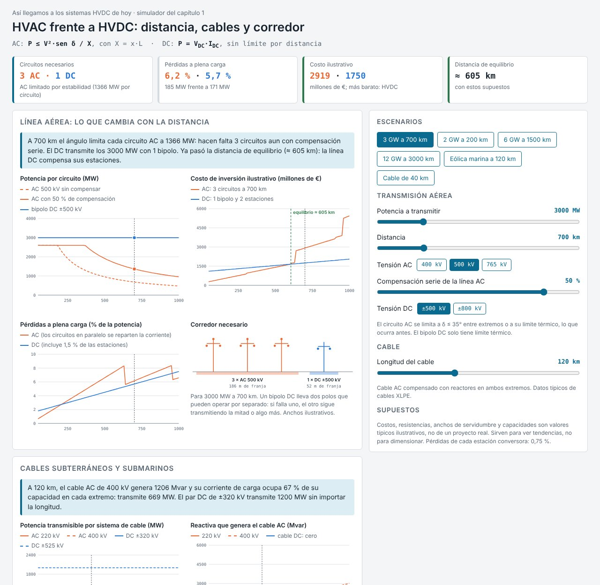

# Así llegamos a los sistemas HVDC de hoy

Capítulo 1 de un posible libro sobre transmisión HVDC, con su simulador interactivo.

- **Simulador:** [HVAC frente a HVDC: distancia, cables y corredor](https://ajrcjf-web.github.io/hvdc-de-hoy/)
- **Capítulo en PDF:** [docs/capitulo-1-asi-llegamos-a-los-sistemas-hvdc-de-hoy.pdf](docs/capitulo-1-asi-llegamos-a-los-sistemas-hvdc-de-hoy.pdf)

## Qué muestra el simulador

Compara una transmisión en corriente alterna con un enlace HVDC para la misma potencia y distancia:

- potencia por circuito AC (límite de estabilidad con δ ≤ 35° o límite térmico) frente al bipolo DC;
- costo de inversión ilustrativo y distancia de equilibrio;
- pérdidas a plena carga, incluidas las estaciones conversoras;
- ancho del corredor necesario;
- potencia transmisible por cables AC (220 y 400 kV) y DC (±320 y ±525 kV) según la longitud, y la reactiva que genera el cable AC.

Escenarios con enlace directo: `#equilibrio`, `#linea-corta`, `#corredor`, `#uhvdc`, `#eolica`, `#cable-corto`.

Los costos, resistencias y anchos de franja son valores típicos ilustrativos, no de un proyecto real: sirven para ver tendencias, no para dimensionar.

## Simuladores relacionados

- [Flujo de potencia AC](https://ajrcjf-web.github.io/ac-power-flow-simulator/)
- [HVDC: LCC frente a VSC](https://ajrcjf-web.github.io/hvdc-lcc-vs-vsc-simulator/)
- [Roles de control HVDC](https://ajrcjf-web.github.io/hvdc-control-roles-simulator/)
- [La ecuación de la potencia AC](https://ajrcjf-web.github.io/ecuacion-potencia-ac/)

## Uso

Es una sola página HTML sin dependencias de compilación: abrir `index.html` en el navegador o publicarlo con GitHub Pages (rama `main`, carpeta raíz).

## Licencia

MIT. Autor: ing. Angel Rojas.
