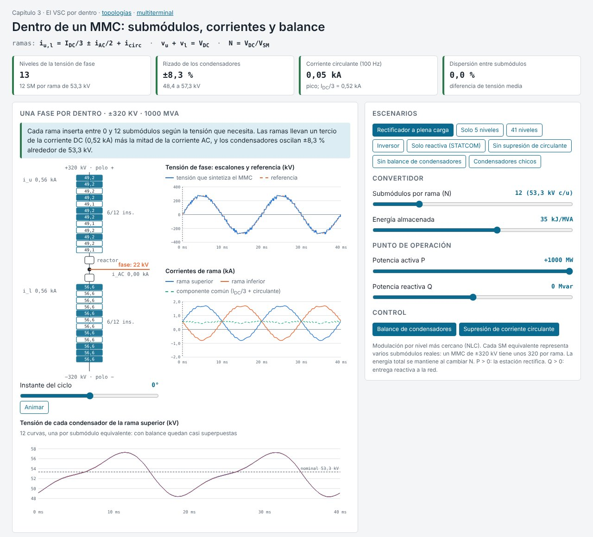
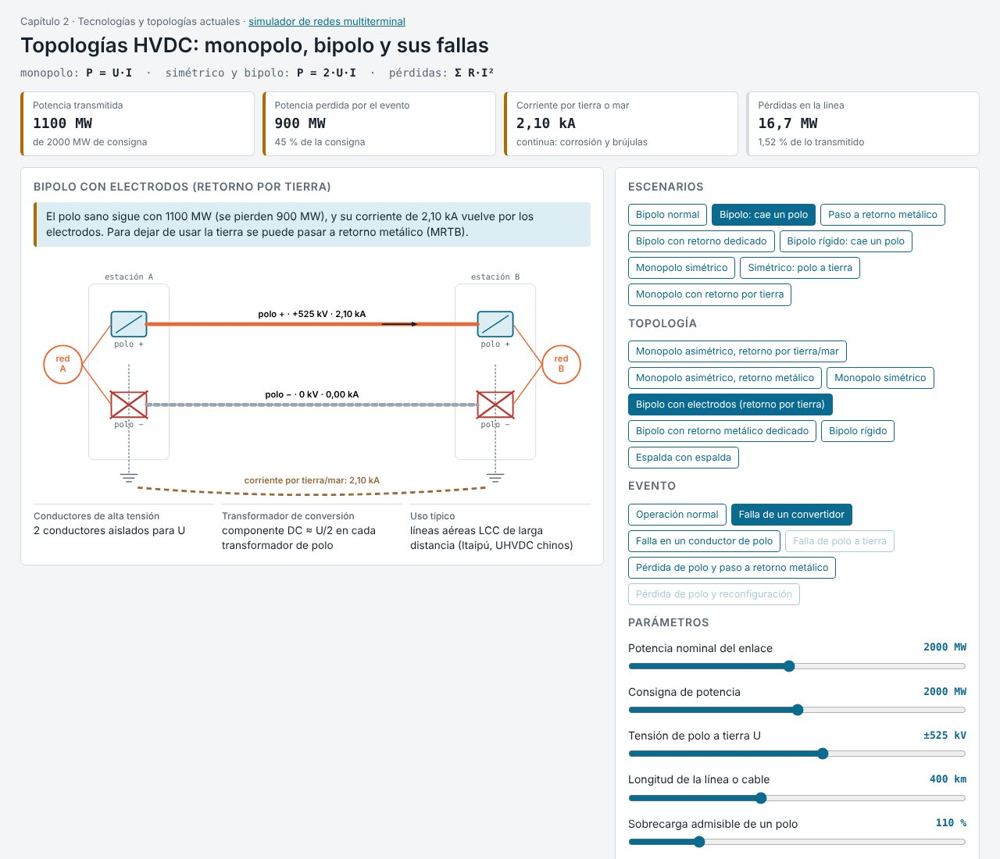

# HVDC de hoy

Capítulos de un posible libro sobre transmisión HVDC, cada uno con sus simuladores interactivos.

## Capítulo 3 · El VSC por dentro

- **Capítulo en PDF:** [docs/capitulo-3-el-vsc-por-dentro.pdf](docs/capitulo-3-el-vsc-por-dentro.pdf)
- **Simulador:** [Dentro de un MMC: submódulos, corrientes y balance](https://ajrcjf-web.github.io/hvdc-de-hoy/mmc.html). Escenarios: `#base`, `#pocos-niveles`, `#muchos-niveles`, `#inversor`, `#reactiva`, `#sin-supresion`, `#sin-balance`, `#poca-energia`.

## Capítulo 2 · Tecnologías y topologías actuales

- **Capítulo en PDF:** [docs/capitulo-2-tecnologias-y-topologias-actuales.pdf](docs/capitulo-2-tecnologias-y-topologias-actuales.pdf)
- **Simulador:** [Topologías HVDC: monopolo, bipolo y sus fallas](https://ajrcjf-web.github.io/hvdc-de-hoy/topologias.html). Escenarios: `#bipolo`, `#bipolo-falla`, `#mrtb`, `#dmr`, `#rigido`, `#simetrico`, `#simetrico-tierra`, `#asimetrico`, `#uhvdc-grupo`.
- **Simulador:** [Redes HVDC multiterminal: estación maestra y droop](https://ajrcjf-web.github.io/hvdc-de-hoy/multiterminal.html). Escenarios: `#maestra`, `#pierde-eolica`, `#maestra-satura`, `#pierde-maestra`, `#droop`, `#droop-pierde`, `#droop-satura`, `#anillo`.

## Capítulo 1 · Así llegamos a los sistemas HVDC de hoy

- **Simulador:** [HVAC frente a HVDC: distancia, cables y corredor](https://ajrcjf-web.github.io/hvdc-de-hoy/)
- **Capítulo en PDF:** [docs/capitulo-1-asi-llegamos-a-los-sistemas-hvdc-de-hoy.pdf](docs/capitulo-1-asi-llegamos-a-los-sistemas-hvdc-de-hoy.pdf)

### Qué muestra el simulador del capítulo 1

Compara una transmisión en corriente alterna con un enlace HVDC para la misma potencia y distancia:

- potencia por circuito AC (límite de estabilidad con δ ≤ 35° o límite térmico) frente al bipolo DC;
- costo de inversión ilustrativo y distancia de equilibrio;
- pérdidas a plena carga, incluidas las estaciones conversoras;
- ancho del corredor necesario;
- potencia transmisible por cables AC (220 y 400 kV) y DC (±320 y ±525 kV) según la longitud, y la reactiva que genera el cable AC.

Escenarios con enlace directo: `#equilibrio`, `#linea-corta`, `#corredor`, `#uhvdc`, `#eolica`, `#cable-corto`.

Los costos, resistencias y anchos de franja son valores típicos ilustrativos, no de un proyecto real: sirven para ver tendencias, no para dimensionar.

## Simuladores relacionados

- [Flujo de potencia AC](https://ajrcjf-web.github.io/ac-power-flow-simulator/)
- [HVDC: LCC frente a VSC](https://ajrcjf-web.github.io/hvdc-lcc-vs-vsc-simulator/)
- [Roles de control HVDC](https://ajrcjf-web.github.io/hvdc-control-roles-simulator/)
- [La ecuación de la potencia AC](https://ajrcjf-web.github.io/ecuacion-potencia-ac/)

## Uso

Cada simulador es una sola página HTML sin dependencias de compilación: abrir `index.html`, `topologias.html`, `multiterminal.html` o `mmc.html` en el navegador o publicarlo con GitHub Pages (rama `main`, carpeta raíz).

## Licencia

MIT. Autor: ing. Angel Rojas.
